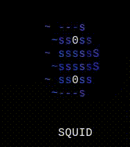

# Pixlz
### The weirdest text animator



Pixlz is a library that wraps around tkinter to produce a GUI that displays your text-based animations.
Is it a pain? maybe...
Is it cool? I think so!!

I'm not an animator, nor an artist, but I thought this would be cool. It makes creating text-based animations easier but a-trillion times more tedious. **try it now!**

It's really easy to use, this is what your main script could look like minimally:

```python
import pixlz

anim = Pixlz()
anim.exec()
```

That alone is enough to run your animation. you can do some more fancy stuff, though:

```python
import pixlz

anim = Pixlz(title="Cool!")
anim.config(
	xres=30, yres=21, # change number of characters on x and y
	fps=3, # change frames/s
	font="Courier", # change to any tkinter supported font
	font_size=12, # font size
	bg="green", # background colour
)
anim.exec()
```

<br>

pixlz expects your animations to be inside `anims/` directory by your main file. Each frame is a file. The first frame is called `pxz0.py`, the second is `pxz1.py`, etc. etc.

Your pxz frame files should look like this:

```python
frame=(
	('X', (R, G, B)) # output character with RGB colours
)
```

Add on more for more characters

```python
frame=(
	(' ', (0, 0, 0)), ('C', (255, 255, 255)), ('O', (255, 255, 255)), ('O', (255, 255, 255)), ('L', (255, 255, 255)), (' ', (0, 0, 0))
)
```

That's one frame, just make sure to update your `xres` and `yres` to match the resolution